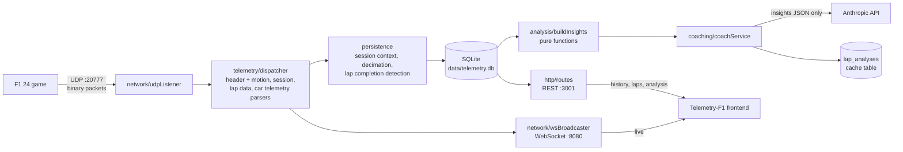

# TelemetryF1_API

[](https://github.com/AnaLauraFFerraz/TelemetryF1_API/actions/workflows/ci.yml)

Backend for **F1 24** game telemetry. It ingests the game's binary UDP stream, persists sessions and laps to SQLite, streams live data over WebSocket, serves history over REST, and runs a deterministic lap-analysis engine with an AI coach on top of it.

The problem it solves: the game broadcasts packed binary structs at up to 60 Hz and keeps none of them. This service turns that stream into structured, queryable laps and explains *where* time was lost between two laps.

Frontend: [Telemetry-F1](https://github.com/AnaLauraFFerraz/Telemetry-F1).

> Screenshots / GIF: _to be added._

## Architecture



| Path | Responsibility |
|---|---|
| `src/config/` | `env.ts` loads and validates the ports and fails fast (local mode only); `dbPath.ts` resolves the database path (including `DB_PATH`, and an in-memory database in demo mode) and is the only config file the persistence layer imports, so persistence does not depend on the ports; `mode.ts` reads `DEMO_MODE`; `demoEnv.ts` validates the demo settings; `projectRoot.ts` finds the folder holding `package.json` |
| `src/network/` | UDP socket; WebSocket server with a ping/pong heartbeat every 15 s |
| `src/ws/` | WebSocket message envelope |
| `src/telemetry/` | Binary parsers for packet ids 0 (motion), 1 (session, partial), 2 (lap data) and 6 (car telemetry), over a little-endian `BufferCursor`; each full parser asserts the exact byte count |
| `src/persistence/` | SQLite schema, per-session in-memory state, decimation, lap completion detection, one repository per table; samples are deduplicated by `(session_id, overall_frame_identifier)`, since a packet's frame identifier survives a flashback and a looped or repeated replay unscathed, unlike session time or lap distance |
| `src/analysis/` | Pure, deterministic lap analysis producing a compact `LapInsights` JSON |
| `src/coaching/` | Static system prompt, user-message builder, Anthropic call with typed errors |
| `src/http/` | Express REST API and `GET /health`; `createApp` builds the same app for both modes, with the demo's CORS and cache headers in demo mode |
| `src/demo/` | Everything only demo mode runs: the recording check, the in-process session build, capture times, the coach seed's validation and export, the single-car message, the demo WebSocket server and its log, and `demoServer.ts`, which wires the start sequence |
| `src/replay/` | Pure replay pacing (`computeDelayMs`) and the orchestration loop (`runReplay`): speed, loop, absolute-deadline scheduling so error does not accumulate over a long recording |
| `src/tooling/` | Tests of the project's own tooling: the test of the empty-discovery guard |
| `tools/` | Recorder, an offline `analyze` CLI, a thin replayer CLI over `src/replay/`, `fetchDemoRecording.ts` (the last step of `npm run build`: downloads and verifies the demo recording), `exportCoachSeed.ts` (the maintainer's paid, one-off export of `demo/coach-seed.json`), and `assertTestFiles.ts`, the guard that runs as the `pretest` of `npm test` |

## Features

- **UDP ingestion and parsing** of the F1 24 protocol (`packetFormat` 2024). Malformed or foreign packets are logged and dropped without crashing the process.
- **Persistence**: sessions, completed laps (time, sectors, validity) and decimated per-lap samples of car telemetry and motion. The track id is read from the session packet.
- **Lap completion detection** based on the highest lap number seen, so lost or out-of-order UDP packets do not create false laps. Missing sector data is stored as `NULL`.
- **Live WebSocket stream** of motion, lap data and car telemetry (all 22 cars per message; in demo mode, only the player's car, with `playerCarIndex` 0, see "Demo mode").
- **REST API**:

  | Method | Path | Description |
  |---|---|---|
  | GET | `/sessions` | Sessions with lap count and best valid lap |
  | GET | `/sessions/:id` | Session and its laps |
  | GET | `/sessions/:id/benchmark` | Best valid lap and theoretical best (best sectors) on the session's track, across all recorded sessions |
  | GET | `/sessions/:id/laps/:lapNumber/telemetry` | Decimated car telemetry and motion samples for a lap |
  | POST | `/sessions/:id/analysis` | Body `{ lapA, lapB }`; returns `{ analysis, insights, cached }` |
  | GET | `/health` | `200 {"status":"ok"}`; in demo mode, `503 {"status":"replay stopped"}` once the replay loop has stopped. Never cached |

- **Lap analysis engine** (`npm run analyze`, also used by the coach): corner detection from the speed trace, braking point and trail braking, throttle pick-up, coasting and throttle oscillation, per-corner time loss, lateral line deviation between laps, and tyre surface temperature excursions.
- **AI coach**: turns the insights of two laps into pit-engineer style advice in Portuguese, with results cached per lap pair.
- **Recorder and replayer** to capture a real session once and work without the game afterwards, replaying at the original pace by default, with `1x`/`2x`/`max` speed options and an optional loop for a continuous demo.

## Getting started

Requirements: Node.js ≥ 22.17. The major version (22) is pinned in `.nvmrc`, which fnm, nvm and `actions/setup-node` all read.

```bash
npm install
cp .env.example .env    # WS_PORT, UDP_PORT, HTTP_PORT; ANTHROPIC_API_KEY is optional
npm run dev
```

To run the compiled server instead of `ts-node-dev`:

```bash
npm run build           # compiles src/ and tools/ to dist/ with tsconfig.build.json (tests excluded),
                        # then downloads and verifies the demo recording (see "Demo mode")
npm start               # runs dist/src/server.js, with the same .env
```

In the game, enable UDP telemetry under *Settings → Telemetry*: IP `127.0.0.1`, port `20777`, UDP format `2024`.

Without `ANTHROPIC_API_KEY` everything works except new coach analyses, which return HTTP 503.

### Running without the game

A sample recording is published as a release asset (not committed to git): [sample-recording-v1](https://github.com/AnaLauraFFerraz/TelemetryF1_API/releases/tag/sample-recording-v1).

| | |
|---|---|
| File | `demo-interlagos-tt-20hz-laps6-8.jsonl` (25.2 MB, 13,960 packets, 222.8 s) |
| Session | Time Trial at Interlagos, Red Bull, 20 Hz send rate |
| Assists | Automatic gearbox, ABS, medium traction control |
| Laps | 6 (1:14.306, invalid), 7 (1:14.144), 8 (1:13.372, best valid lap) |
| Packets | Motion, session, lap data, event and car telemetry, plus the latest participants, car setups and time trial packets at the start; cut from a longer session, no flashback |
| SHA-256 | `c41bdfaf7ff0feb40702875b15031654742de5fdb10ea3a05c0a21f1ac70b033` |

```bash
mkdir -p recordings
curl -L -o recordings/demo-interlagos-tt-20hz-laps6-8.jsonl \
  https://github.com/AnaLauraFFerraz/TelemetryF1_API/releases/download/sample-recording-v1/demo-interlagos-tt-20hz-laps6-8.jsonl
npm run dev                                     # in another terminal
npm run replay -- recordings/demo-interlagos-tt-20hz-laps6-8.jsonl
```

In the frontend's session analysis, lap 8 opens as the primary lap because it is the most recent. No comparison lap is pre-selected, since lap 8 is also the best valid lap: select lap 7, the second-best valid lap, as the comparison.

To capture your own session:

```bash
npm run record                                  # stop `npm run dev` first: both bind the UDP port
# drive in the game, then Ctrl+C
```

The replayer honours each packet's original timing by default (`--speed=1x`). `--speed=2x` halves the wait between packets; `--speed=max` re-sends everything as fast as possible (the previous default behaviour) for when fidelity does not matter and raw speed does. `--loop` restarts the recording from the beginning on reaching its end, for a continuous public demo — use `1x` or `2x` for this: see Known limitations below for why `max` is unsuitable for a continuous loop.

```bash
npm run replay -- recordings/demo-interlagos-tt-20hz-laps6-8.jsonl --speed=2x
npm run replay -- recordings/demo-interlagos-tt-20hz-laps6-8.jsonl --loop
```

Validated against the published Interlagos recording: the session, track, every completed lap, its time, sectors and validity are reproduced exactly, same as before. At `1x`, all 2,411 per-distance samples the decimation rule predicts for this recording arrive — up from the 14.6% an unpaced replay of the same file delivers. The live dashboard stays updated throughout a paced replay instead of only flashing at the end, and the session's start and last-seen times still reflect the replay's wall clock, not the original capture time.

To inspect the analysis for two laps without calling the AI:

```bash
npm run analyze -- <sessionId> <lapA> <lapB>
```

## Demo mode

> **Partial: being built on this branch (spec 003).** The demo server runs end to end, but the repository has no coach seed yet: the first export was rejected at review, and the seed will be produced again after two smaller specs (the coach's input and prompt, and artifacts of the analysis engine). Until then, `DEMO_MODE=true npm start` stops with `[demo] cache do coach não encontrado em …` unless `DEMO_SEED_PATH` points at a seed made for the recording in use.

**What it does.** A self-contained public demonstration on a host that exposes a single port and keeps no disk. At every start, in this order, before listening:

1. validates the settings below;
2. reads the coach seed and checks the recording's SHA-256 against the one the seed names (in production, the published recording's); a missing recording, a missing or malformed seed, or a mismatch stops the start;
3. builds the whole session in an in-memory database, feeding every packet of the recording through the same parsers and persistence as UDP ingestion (no UDP socket is opened in demo mode);
4. rewrites the session's start and last-seen times and each lap's time to the recording's own capture times (`receivedAt`), so the history shows the 2026-10-16 capture and a 4-minute session however long the demo runs;
5. validates the seed against the built session (its session UID, its laps, and each pair's insights against today's analysis, structurally, with numbers within 0.01 + 1e-9) and loads it into the coach cache; any difference beyond that stops the start, naming the pair;
6. switches the database to read-only (`PRAGMA query_only`), so any later write fails inside SQLite;
7. listens on `PORT` (`0.0.0.0`) with REST and WebSocket on that one port, and starts replaying the recording at `1x` in a loop, broadcast only (the loop never writes to the database).

The log line `[demo] pronto em <ms> ms (montagem …, hash …, cache …; compressão do WebSocket ligada|desligada)` marks the end of the start.

**WebSocket in demo mode.** Same message shape as local mode, but each message's `data` holds only the player's car and `playerCarIndex` is always `0`. Messages are compressed with per-message deflate when the client offers it (every current browser does); `DEMO_WS_COMPRESSION=false` turns compression off without a code change. At most `DEMO_MAX_CONNECTIONS` connections (default 5): one more is accepted and closed at once with code `4001`, reason `demo full`. Each connection is closed after `DEMO_MAX_CONNECTION_MINUTES` (default 5) with code `4002`, reason `time limit`; the server never reopens it. A handshake from a browser origin other than `DEMO_ALLOWED_ORIGIN` gets HTTP `403`; a client without an `Origin` header is accepted.

**REST in demo mode.** CORS answers only `DEMO_ALLOWED_ORIGIN` (exact match). This, like the WebSocket origin check, only limits use from browsers: a script sends whatever `Origin` it wants, so it is not an access control, and nothing a client sends can write to the database or trigger a paid call anyway. The four read routes carry `Cache-Control: no-cache` with Express's ETag, so a browser revalidates and gets `304` while the data is unchanged; `POST /sessions/:id/analysis` and `GET /health` carry `Cache-Control: no-store`. The application does not compress REST responses: the hosting platform's load balancers do. There is no per-IP request limit.

**The coach in demo mode.** Seeded pairs are answered from the cache (`cached: true`); any other pair gets the existing `503` body. Demo mode refuses to start with `ANTHROPIC_API_KEY` set, so it can never call the API.

**Health.** `GET /health` answers `200 {"status":"ok"}` while the replay loop runs and `503 {"status":"replay stopped"}` if it has stopped. Since the server only listens once the demo is ready, a probe during the start finds no listener.

**Logging in demo mode.** No per-packet lines. The log has the start and the time until ready, each new pass of the loop, each WebSocket connection opened and closed with its code (normal, `4001 demo full`, `4002 time limit`, `403` origin refusal), and every 15 minutes a summary line: open connections, bytes written to the sockets by the application over WebSocket and over REST and their sum, coach `503` count, and process CPU time. The byte counts are what the application writes (after WebSocket compression, before the platform's HTTP compression), not the platform's billing figure. No IP address is logged.

**The recording.** `npm run build` ends by downloading the published recording ([sample-recording-v1](https://github.com/AnaLauraFFerraz/TelemetryF1_API/releases/tag/sample-recording-v1)) to `recordings/demo-interlagos-tt-20hz-laps6-8.jsonl` (or `DEMO_RECORDING_PATH`) and checking its SHA-256 against the one published in "Running without the game". If a verified copy is already there, nothing is downloaded. The download goes to a temporary file next to the destination and replaces it only after the check; a failed download or a mismatch fails the build and leaves any existing file as it was. An existing file with the wrong hash is replaced by a verified download, with a log line.

Demo mode is selected with `DEMO_MODE=true` and is off by default. With it on, the three local ports are not read, and the database is always in memory (`data/telemetry.db` is never opened).

| Variable | Required | Rule | Default |
|---|---|---|---|
| `DEMO_MODE` | to enable | `true` turns demo mode on; unset or empty is local mode; any other value stops the server | — |
| `PORT` | yes | integer 1–65535 | — |
| `DEMO_ALLOWED_ORIGIN` | yes | one origin, `scheme://host[:port]`, no path, no trailing slash | — |
| `DEMO_MAX_CONNECTIONS` | no | integer ≥ 1 | `5` |
| `DEMO_MAX_CONNECTION_MINUTES` | no | integer ≥ 1 | `5` |
| `DEMO_WS_COMPRESSION` | no | `true` or `false`; unset or empty is `true`; any other value stops the server | `true` |
| `DEMO_RECORDING_PATH` | no | path to the recording | `recordings/demo-interlagos-tt-20hz-laps6-8.jsonl` |
| `DEMO_SEED_PATH` | no | path to the coach seed file | `demo/coach-seed.json` |
| `ANTHROPIC_API_KEY` | **must not be set** | the server stops: demo mode never makes a paid call | — |
| `DB_PATH` | **must not be set** | the server stops: the demo database is always in memory | — |

Every check runs at startup, before any port is bound, and stops the server with a message naming the variable.

**The coach seed.** Demo mode never calls the AI coach; its comparisons come from a versioned file, `demo/coach-seed.json`, which the maintainer produces once with a paid export. The file is public once committed, so it holds only the recording's identity (its SHA-256 and session UID) and, for each ordered pair of laps, the insights, the coach's text and the model name: nothing about the account, the request or the usage. The export:

```bash
DB_PATH=:memory: ANTHROPIC_API_KEY=<your key> npm run export-coach-seed
```

- builds the session from the published recording in a disposable database (it refuses an unset `DB_PATH` and any spelling of `data/telemetry.db`, and refuses to run without a key);
- asks the coach for the six ordered pairs of laps 6, 7 and 8, printing each call's token usage;
- rewrites the file after each paid pair, atomically (a temporary file in `demo/` renamed over `coach-seed.json`), so an interrupted run keeps every pair it paid for and never leaves half a JSON;
- reuses a pair already in the file when the recording, the model and the insights still match, so a second run makes no call, and a run after an interrupted one asks only for the missing pairs. Insights are compared structurally, with numbers equal within 0.01 + 1e-9, because the file is made on one machine and checked on another, possibly with another engine version.

Run it only on your own machine, with a spending limit set in the Anthropic Console, and never set the key where the demo runs. The step-by-step is in `specs/003-demo-mode/quickstart.md`, section D. Demo mode refuses to start while the file is missing.

## Tests

```bash
npm test          # node:test via ts-node; finds every src/**/*.test.ts
npm run typecheck # type-check (src/ and tools/)
```

`npm test` first runs a guard (`pretest`) that fails when no test file is found, because `node --test` exits 0 on an empty glob.

The tests cover pure logic (decimation, lap completion detection, every analysis module, the coach's user-message builder, replay pacing) with synthetic data, plus the sample repositories' deduplication and one end-to-end test of the replay path against a real UDP socket and an isolated, disposable database. In demo mode, the HTTP app (CORS, cache headers, health, the coach's cached and `503` answers), the demo WebSocket server and the whole server are tested, the last one spawned against a synthetic recording and seed generated by the test. The local-mode routes and the local WebSocket server are not covered yet.

## CI and branch protection

The workflow in `.github/workflows/ci.yml` runs on every pull request to `main` and on every push to `main`, on Linux only. It has two independent jobs, `typecheck` (`npm run typecheck`) and `test` (`npm test`), so the pull request's checks list shows which one failed. It needs no secret and asks for read-only repository access.

**The check names are a contract.** Renaming a job (`typecheck`, `test`) requires updating the required checks of the ruleset in the same piece of work; otherwise every pull request waits forever for a check that never reports. Renaming `ci.yml` requires updating the badge above in the same piece of work.

### Protecting `main`

This is done by the maintainer on GitHub, after the workflow is on `main`; it is not stored in the repository. The steps use a **GitHub ruleset** (Settings → Rules → Rulesets → New ruleset → New branch ruleset), not a classic branch protection rule, for three reasons: it is GitHub's current mechanism; its bypass is an explicit list, so an empty list means nobody, administrators included, can get around the rule; and the rules are visible to anyone who reads this public repository.

1. Name the ruleset (for example `main`) and set **Enforcement status** to **Active**.
2. Leave the bypass list empty: do not use **Add bypass**.
3. Under **Target branches**, use **Add a target** to target the default branch, `main`.
4. Enable these branch rules:
   - **Restrict deletions**, so `main` cannot be deleted;
   - **Require linear history**;
   - **Block force pushes**;
   - **Require a pull request before merging**, with the number of required approvals set to **0**. GitHub does not let the author approve their own pull request, and with an empty bypass list a required approval would block every merge by the maintainer, who is the only contributor;
   - **Require status checks to pass before merging**, with **Require branches to be up to date before merging** ticked, so a green pull request that is behind `main` cannot merge, and the checks `typecheck` and `test` added, source GitHub Actions.
5. Save the ruleset with the **Create** button at the bottom of the page. Until then it does not exist: the rules are not enforced and the API lists no ruleset.
6. In the repository's general settings (Settings → General → Pull Requests), keep only **Allow rebase merging** enabled; disable merge commits and squash merging. Also tick **Automatically delete head branches**: GitHub then deletes the remote branch after each merge.

Last resort, if GitHub Actions itself is down: wait first. Only if it stays down, set the ruleset's **Enforcement status** to **Disabled**, merge, set it back to **Active** immediately, and record the reason in the pull request.

## Technical decisions and trade-offs

**SQLite (better-sqlite3, WAL).** Embedded, zero infrastructure, synchronous API that fits a single-process ingestion loop. WAL lets REST reads run while the UDP pipeline writes. The trade-off is a single writer and a file on local disk, which limits horizontal scaling and needs care on hosts with ephemeral storage.

**Hybrid decimation (4 m or 500 ms).** At 60 Hz a lap produces thousands of samples per packet type. A sample is kept when the car moved at least 4 m *or* 500 ms passed since the last kept sample. Distance-only would stop recording when the car is stationary (garage, pit), and time-only would cluster points in slow corners and thin them out on straights. Distance spacing keeps the charts' x-axis uniform.

The game's send rate sets the other limit. The recording used for validation was made at **20 Hz**. At 300 km/h the car covers about 4.2 m between packets, so at high speed the send rate, not the decimation, is the bottleneck; in slower sections decimation keeps one sample per 4 m. Either way the stored resolution is roughly one point every 4 m along the lap, and braking points, throttle pick-up and line deviation cannot be located more precisely than that. A 60 Hz recording would give about three times the raw density at the same speed, with decimation then capping it at 4 m.

**The coach receives insights, never raw samples.** The deterministic engine extracts the facts (where, how much, which input differed) and only that JSON goes to the model, which is responsible for prioritising and explaining. Raw samples would cost far more tokens, invite numerical hallucination and make the analysis impossible to test. All the arithmetic lives in `src/analysis/`, covered by unit tests.

**Static system prompt.** The coach's system prompt is a constant, never interpolated, and all variable content goes in the user message. This is the precondition for Anthropic prompt caching, and the request marks the system block with `cache_control`. **What happens today:** Anthropic only caches a prefix above a model-specific minimum length ([prompt caching docs](https://platform.claude.com/docs/en/build-with-claude/prompt-caching)); a shorter one is processed normally, with no cache entry and no error. The coach's system prompt measures 1,378 tokens for `claude-opus-4-8` (Anthropic's token-counting endpoint), which is below that minimum, so it is not cached today. Each call logs its token usage (`[coachService] usage ... cache_write=… cache_read=…`) to confirm this at runtime. What actually avoids repeated cost is the `lap_analyses` table: an analysed lap pair is never sent to the API again.

**Partial session-packet parser.** Only `sessionType` and `trackId` are read. The full struct contains large variable-length arrays the project does not use yet, so this parser is the only one that does not assert the total byte count.

**Contract ownership.** This repo owns the REST and WebSocket payloads. The frontend mirrors the types by hand, a deliberate trade-off over a shared package for two small repos. In demo mode the WebSocket message keeps its shape but not its content: `data` holds only the player's car and `playerCarIndex` is `0`, so a client must read the car through `playerCarIndex`, never by a fixed index.

## Known limitations

- **Laps with more than one pass over the same distance** produce wrong per-distance analysis. This happens with a flashback, and in Time Trial, where the out-lap shares its lap number with the first flying lap. Lap times and sectors stay correct.
- **The `max` replay speed loses most samples by design** — it exists to reach the end of a long recording quickly when fidelity does not matter. `1x` and `2x` do not lose samples.
- **`--speed=max` combined with `--loop` delivers practically no samples**: with no gap between an already-fast pass and the next, the flood is continuous rather than a one-off burst, and measured delivery dropped to effectively zero. For a continuous public demo, use `1x` or `2x`.
- **A looped replay of a very short recording** does not reset its in-memory lap/decimation state at the loop boundary: if a recording's own `overallFrameIdentifier` span is 100 frames or less (roughly 5 seconds), the next pass carries over stale state instead of starting fresh. Recordings of a lap or more are unaffected — the published Interlagos recording spans about 4,500 frames.
- **The analysis cache** is keyed only by session and lap pair. It ignores the model, the prompt version and later benchmark changes.
- **Error responses** are plain strings in mixed languages, and the frontend matches some of them literally.
- **Switching the Node major without running `npm ci` again** makes `better-sqlite3` fail to load with `ERR_DLOPEN_FAILED`: its native binary is built for one major's ABI.
- **Replaying an old recording stretches its session's duration.** A replay re-sends the original packets, so it writes into the session the recording came from, if that session is already in the database, and moves its last-seen time to now: the history then shows a duration from the original capture to the time of the replay.
- **The demo seeds six lap pairs, but the frontend reaches only two.** The coach seed covers the six ordered pairs of laps 6, 7 and 8; today's frontend fixes the primary lap to the latest one (lap 8), so only (8, 6) and (8, 7) can be requested. The other four are ready for a frontend that lets the visitor change the primary lap.
- **The demo's monthly bandwidth.** The free hosting includes 5 GB of outbound bandwidth a month, about 1,330–2,410 full demo visits (spec 003 research, point 1); without a payment method, the platform suspends the service until the next month when it runs out.
- **No per-IP limit in demo mode.** The platform's documentation does not state how it forwards the visitor's address, so one client can spend the allowance by itself.
- **Whether the browser's pong frames keep the demo awake is undocumented** by the platform; the 5-minute connection limit bounds how long an abandoned tab can keep it awake.
- **The demo shows only the player's car** in the live stream.
- **WebSocket compression costs an estimated 11–12% of the free instance's CPU per connection** (measured locally at 1.1–1.2% of one core, not on the platform). `DEMO_WS_COMPRESSION=false` is the way out.
- No lint script yet.

## Next steps

Planned with Spec Driven Development (spec, plan and tasks are committed before the code):

1. **Multiple passes per lap**: detect flashbacks (event `FLBK`, session time going back, `frameIdentifier` diverging from `overallFrameIdentifier`) and the Time Trial out-lap sharing a lap number, and keep only the valid pass.
2. **Parser tests with real packets** extracted from a recording.
3. **Stable error codes**, e.g. `{ code: "SESSION_NOT_FOUND", message }`, with the frontend deciding by code, and a single language for messages.
4. **Single source for tyre temperature windows**: the API exposes the windows and the frontend consumes them, replacing the two diverging hard-coded ranges. Open question to settle in the spec: whether the ideal window in F1 24 depends on the tyre compound.
5. **Coach input**: tell the coach which laps it compares and their official times, the sign conventions, and label each corner as the frontend does.
6. **Analysis engine artifacts**: overlapping corner search windows, a braking start that stops at the apex, and a throttle pick-up shared by neighbouring corners (spec 003 research, "Analysis engine observations").
7. **Public demo deploy**, once the coach seed exists (see "Demo mode"), and a **build** and **lint** step in the CI (which already runs the type-check and the tests).
