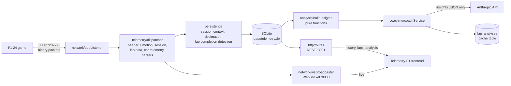

# TelemetryF1_API

Backend for **F1 24** game telemetry. It ingests the game's binary UDP stream, persists sessions and laps to SQLite, streams live data over WebSocket, serves history over REST, and runs a deterministic lap-analysis engine with an AI coach on top of it.

The problem it solves: the game broadcasts packed binary structs at up to 60 Hz and keeps none of them. This service turns that stream into structured, queryable laps and explains *where* time was lost between two laps.

Frontend: [Telemetry-F1](https://github.com/AnaLauraFFerraz/Telemetry-F1).

> Screenshots / GIF: _to be added._

## Architecture



| Path | Responsibility |
|---|---|
| `src/network/` | UDP socket; WebSocket server with a ping/pong heartbeat every 15 s |
| `src/telemetry/` | Binary parsers for packet ids 0 (motion), 1 (session, partial), 2 (lap data) and 6 (car telemetry), over a little-endian `BufferCursor`; each full parser asserts the exact byte count |
| `src/persistence/` | SQLite schema, per-session in-memory state, decimation, lap completion detection, one repository per table |
| `src/analysis/` | Pure, deterministic lap analysis producing a compact `LapInsights` JSON |
| `src/coaching/` | Static system prompt, user-message builder, Anthropic call with typed errors |
| `src/http/` | Express REST API |
| `tools/` | Recorder, replayer and an offline `analyze` CLI |

## Features

- **UDP ingestion and parsing** of the F1 24 protocol (`packetFormat` 2024). Malformed or foreign packets are logged and dropped without crashing the process.
- **Persistence**: sessions, completed laps (time, sectors, validity) and decimated per-lap samples of car telemetry and motion. The track id is read from the session packet.
- **Lap completion detection** based on the highest lap number seen, so lost or out-of-order UDP packets do not create false laps. Missing sector data is stored as `NULL`.
- **Live WebSocket stream** of motion, lap data and car telemetry (all 22 cars per message).
- **REST API**:

  | Method | Path | Description |
  |---|---|---|
  | GET | `/sessions` | Sessions with lap count and best valid lap |
  | GET | `/sessions/:id` | Session and its laps |
  | GET | `/sessions/:id/benchmark` | Best valid lap and theoretical best (best sectors) on the session's track, across all recorded sessions |
  | GET | `/sessions/:id/laps/:lapNumber/telemetry` | Decimated car telemetry and motion samples for a lap |
  | POST | `/sessions/:id/analysis` | Body `{ lapA, lapB }`; returns `{ analysis, insights, cached }` |

- **Lap analysis engine** (`npm run analyze`, also used by the coach): corner detection from the speed trace, braking point and trail braking, throttle pick-up, coasting and throttle oscillation, per-corner time loss, lateral line deviation between laps, and tyre surface temperature excursions.
- **AI coach**: turns the insights of two laps into pit-engineer style advice in Portuguese, with results cached per lap pair.
- **Recorder and replayer** to capture a real session once and work without the game afterwards.

## Getting started

Requirements: Node.js ≥ 22.6.

```bash
npm install
cp .env.example .env    # WS_PORT, UDP_PORT, HTTP_PORT; ANTHROPIC_API_KEY is optional
npm run dev
```

In the game, enable UDP telemetry under *Settings → Telemetry*: IP `127.0.0.1`, port `20777`, UDP format `2024`.

Without `ANTHROPIC_API_KEY` everything works except new coach analyses, which return HTTP 503.

### Running without the game

You need a recording. No recording is committed to this repository yet (a sample session is planned for the public demo), so capture one once:

```bash
npm run record                                  # stop `npm run dev` first: both bind the UDP port
# drive in the game, then Ctrl+C
npm run dev                                     # in another terminal
npm run replay -- recordings/session-<timestamp>.jsonl
```

The replayer currently re-sends packets **as fast as possible**, ignoring the recorded timing, so the live dashboard only flashes. Decimation and lap detection use the game's own session time rather than wall-clock time, but replay has not yet been validated end to end against a real recording. Real-time replay, and that validation, is the next planned feature.

To inspect the analysis for two laps without calling the AI:

```bash
npm run analyze -- <sessionId> <lapA> <lapB>
```

## Tests

```bash
npm test          # 60 tests, node:test via ts-node
npx tsc --noEmit  # type-check (src/ only)
```

The tests cover pure logic: decimation, lap completion detection, every analysis module, and the coach's user-message builder. They use synthetic data. Parsers, repositories, HTTP routes and the WebSocket server are not covered yet.

## Technical decisions and trade-offs

**SQLite (better-sqlite3, WAL).** Embedded, zero infrastructure, synchronous API that fits a single-process ingestion loop. WAL lets REST reads run while the UDP pipeline writes. The trade-off is a single writer and a file on local disk, which limits horizontal scaling and needs care on hosts with ephemeral storage.

**Hybrid decimation (4 m or 500 ms).** At 60 Hz a lap produces thousands of samples per packet type. A sample is kept when the car moved at least 4 m *or* 500 ms passed since the last kept sample. Distance-only would stop recording when the car is stationary (garage, pit), and time-only would cluster points in slow corners and thin them out on straights. Distance spacing keeps the charts' x-axis uniform.

**The coach receives insights, never raw samples.** The deterministic engine extracts the facts (where, how much, which input differed) and only that JSON goes to the model, which is responsible for prioritising and explaining. Raw samples would cost far more tokens, invite numerical hallucination and make the analysis impossible to test. All the arithmetic lives in `src/analysis/`, covered by unit tests.

**Static system prompt.** The coach's system prompt is a constant, never interpolated, and all variable content goes in the user message. This is the precondition for Anthropic prompt caching, and the request marks the system block with `cache_control`. **What happens today:** Anthropic only caches a prefix above a model-specific minimum length ([prompt caching docs](https://platform.claude.com/docs/en/build-with-claude/prompt-caching)); a shorter one is processed normally, with no cache entry and no error. The coach's system prompt is short and is expected to fall below that minimum, but its token count has not been measured yet. Each call logs its token usage (`[coachService] usage ... cache_write=… cache_read=…`), which is how to confirm it. What actually avoids repeated cost is the `lap_analyses` table: an analysed lap pair is never sent to the API again.

**Partial session-packet parser.** Only `sessionType` and `trackId` are read. The full struct contains large variable-length arrays the project does not use yet, so this parser is the only one that does not assert the total byte count.

**Contract ownership.** This repo owns the REST and WebSocket payloads. The frontend mirrors the types by hand, a deliberate trade-off over a shared package for two small repos.

## Known limitations

- **Flashbacks and lap restarts** merge several passes under one lap number. Lap times and sectors stay correct, but per-distance analysis on those laps is wrong.
- **Replaying the same recording twice** appends duplicate samples (sample tables have no unique constraint).
- **The analysis cache** is keyed only by session and lap pair. It ignores the model, the prompt version and later benchmark changes.
- **Error responses** are plain strings in mixed languages, and the frontend matches some of them literally.
- No build, lint or CI pipeline yet.

## Next steps

Planned with Spec Driven Development (spec, plan and tasks are committed before the code):

1. **Real-time replay**: honour each packet's recorded timestamp, with speed options (1x, 2x, as fast as possible).
2. **Flashback and lap-restart handling**: detect the rewind and discard the aborted pass.
3. **Parser tests with real packets** extracted from a recording.
4. **Stable error codes**, e.g. `{ code: "SESSION_NOT_FOUND", message }`, with the frontend deciding by code, and a single language for messages.
5. **Single source for tyre temperature windows**: the API exposes the windows and the frontend consumes them, replacing the two diverging hard-coded ranges. Open question to settle in the spec: whether the ideal window in F1 24 depends on the tyre compound.
6. **Public demo** running from a recorded session, and **CI** (lint, tests, build) on GitHub Actions.
