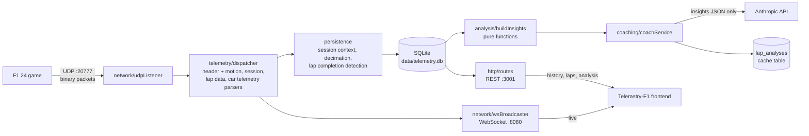

# TelemetryF1_API

[](https://github.com/AnaLauraFFerraz/TelemetryF1_API/actions/workflows/ci.yml)

Backend for **F1 24** game telemetry. It ingests the game's binary UDP stream, persists sessions and laps to SQLite, streams live data over WebSocket, serves history over REST, and runs a deterministic lap-analysis engine with an AI coach on top of it.

The problem it solves: the game broadcasts packed binary structs at up to 60 Hz and keeps none of them. This service turns that stream into structured, queryable laps and explains *where* time was lost between two laps.

Frontend: [Telemetry-F1](https://github.com/AnaLauraFFerraz/Telemetry-F1).

> Screenshots / GIF: _to be added._

## Architecture



| Path | Responsibility |
|---|---|
| `src/config/` | `env.ts` loads and validates the ports and fails fast; `dbPath.ts` resolves the database path (including `DB_PATH`) and is the only config file the persistence layer imports, so persistence does not depend on the ports |
| `src/network/` | UDP socket; WebSocket server with a ping/pong heartbeat every 15 s |
| `src/ws/` | WebSocket message envelope |
| `src/telemetry/` | Binary parsers for packet ids 0 (motion), 1 (session, partial), 2 (lap data) and 6 (car telemetry), over a little-endian `BufferCursor`; each full parser asserts the exact byte count |
| `src/persistence/` | SQLite schema and its migrations (`migrations.ts`), per-session in-memory state, decimation, lap completion detection, one repository per table; samples are deduplicated by `(session_id, overall_frame_identifier)`, since a packet's frame identifier survives a flashback and a looped or repeated replay unscathed, unlike session time or lap distance |
| `src/analysis/` | Pure, deterministic lap analysis producing a compact `LapInsights` JSON |
| `src/coaching/` | Static system prompt, user-message builder, the code's reading of the compared laps and the opportunities (opportunity rule and labels, direction phrases), prompt version, analysis resolver (staleness rule, one call per pair), Anthropic call with typed errors |
| `src/http/` | Express REST API |
| `src/replay/` | Pure replay pacing (`computeDelayMs`) and the orchestration loop (`runReplay`): speed, loop, absolute-deadline scheduling so error does not accumulate over a long recording |
| `src/tooling/` | Tests of the project's own tooling: the test of the empty-discovery guard |
| `tools/` | Recorder, an offline `analyze` CLI (insights, coach message, prompt version), `exportRecordingCut.ts` (regenerates `src/analysis/recordingCut.json` from the published recording), a thin replayer CLI over `src/replay/`, and `assertTestFiles.ts`, the guard that runs as the `pretest` of `npm test` |

## Features

- **UDP ingestion and parsing** of the F1 24 protocol (`packetFormat` 2024). Malformed or foreign packets are logged and dropped without crashing the process.
- **Persistence**: sessions, completed laps (time, sectors, validity) and decimated per-lap samples of car telemetry and motion. The track id is read from the session packet.
- **Lap completion detection** based on the highest lap number seen, so lost or out-of-order UDP packets do not create false laps. Missing sector data is stored as `NULL`.
- **Live WebSocket stream** of motion, lap data and car telemetry (all 22 cars per message).
- **REST API**:

  | Method | Path | Description |
  |---|---|---|
  | GET | `/sessions` | Sessions with lap count and best valid lap |
  | GET | `/sessions/:id` | Session and its laps |
  | GET | `/sessions/:id/benchmark` | Best valid lap and theoretical best (best sectors) on the session's track, across all recorded sessions |
  | GET | `/sessions/:id/laps/:lapNumber/telemetry` | Decimated car telemetry and motion samples for a lap |
  | POST | `/sessions/:id/analysis` | Body `{ lapA, lapB }`; returns `{ analysis, insights, cached }` |

- **Lap analysis engine** (`npm run analyze`, also used by the coach): corner detection from the geometry of the two laps' mean path (the same corners whichever lap is the primary, each with its own stretch of track), braking point and peak, trail braking, throttle pick-up, coasting and throttle oscillation (each measured per lap inside the corner's own stretch; a lap that did not brake, or did not reach full throttle before the next corner, is reported as such rather than as a difference), per-corner time loss, lateral line deviation between laps, and tyre surface temperature excursions.
- **AI coach**: turns the insights of two laps into pit-engineer style advice in Portuguese (the code picks the opportunities), with results cached per lap pair.
- **Recorder and replayer** to capture a real session once and work without the game afterwards, replaying at the original pace by default, with `1x`/`2x`/`max` speed options and an optional loop for a continuous demo.

## Getting started

Requirements: Node.js ≥ 22.17. The major version (22) is pinned in `.nvmrc`, which fnm, nvm and `actions/setup-node` all read.

```bash
npm install
cp .env.example .env    # WS_PORT, UDP_PORT, HTTP_PORT; ANTHROPIC_API_KEY is optional
npm run dev
```

In the game, enable UDP telemetry under *Settings → Telemetry*: IP `127.0.0.1`, port `20777`, UDP format `2024`.

Without `ANTHROPIC_API_KEY` everything works except new coach analyses, which return HTTP 503. Analyses cached with the current prompt version, model and insights are still served; older ones answer 503. A cached analysis counts as current only while its stored insights match the ones computed now from the pair's samples (same tolerance rule as the demo seed); a pair whose samples are gone is not served from the cache and answers 400 (no samples), with or without the key.

**Upgrading an existing database.** The first start of this version adds the column `lap_analyses.prompt_version` to `data/telemetry.db` in place. Before it, with the API stopped, back the database up to a folder outside the repository (the command creates it) and keep the copy until the change is merged:

```bash
node -e "require('fs').mkdirSync('C:/Telemetry/backups',{recursive:true}); const D=require('better-sqlite3'); const db=new D('data/telemetry.db',{readonly:true}); db.exec(\"VACUUM INTO 'C:/Telemetry/backups/telemetry-before-004.db'\"); db.close()"
```

### Running without the game

A sample recording is published as a release asset (not committed to git): [sample-recording-v1](https://github.com/AnaLauraFFerraz/TelemetryF1_API/releases/tag/sample-recording-v1). The one exception is `src/analysis/recordingCut.json`, a cut of laps 6–8 of this recording with only the fields the analysis engine reads (under 660,000 bytes, checked by a test), versioned so the CI can test the engine on real laps. It holds none of the other packets and comes from data already public here; `tools/exportRecordingCut.ts` regenerates it.

| | |
|---|---|
| File | `demo-interlagos-tt-20hz-laps6-8.jsonl` (25.2 MB, 13,960 packets, 222.8 s) |
| Session | Time Trial at Interlagos, Red Bull, 20 Hz send rate |
| Assists | Automatic gearbox, ABS, medium traction control |
| Laps | 6 (1:14.306, invalid), 7 (1:14.144), 8 (1:13.372, best valid lap) |
| Packets | Motion, session, lap data, event and car telemetry, plus the latest participants, car setups and time trial packets at the start; cut from a longer session, no flashback |
| SHA-256 | `c41bdfaf7ff0feb40702875b15031654742de5fdb10ea3a05c0a21f1ac70b033` |

```bash
mkdir -p recordings
curl -L -o recordings/demo-interlagos-tt-20hz-laps6-8.jsonl \
  https://github.com/AnaLauraFFerraz/TelemetryF1_API/releases/download/sample-recording-v1/demo-interlagos-tt-20hz-laps6-8.jsonl
npm run dev                                     # in another terminal
npm run replay -- recordings/demo-interlagos-tt-20hz-laps6-8.jsonl
```

In the frontend's session analysis, lap 8 opens as the primary lap because it is the most recent. No comparison lap is pre-selected, since lap 8 is also the best valid lap: select lap 7, the second-best valid lap, as the comparison.

To capture your own session:

```bash
npm run record                                  # stop `npm run dev` first: both bind the UDP port
# drive in the game, then Ctrl+C
```

The replayer honours each packet's original timing by default (`--speed=1x`). `--speed=2x` halves the wait between packets; `--speed=max` re-sends everything as fast as possible (the previous default behaviour) for when fidelity does not matter and raw speed does. `--loop` restarts the recording from the beginning on reaching its end, for a continuous public demo — use `1x` or `2x` for this: see Known limitations below for why `max` is unsuitable for a continuous loop.

```bash
npm run replay -- recordings/demo-interlagos-tt-20hz-laps6-8.jsonl --speed=2x
npm run replay -- recordings/demo-interlagos-tt-20hz-laps6-8.jsonl --loop
```

Validated against the published Interlagos recording: the session, track, every completed lap, its time, sectors and validity are reproduced exactly, same as before. At `1x`, all 2,411 per-distance samples the decimation rule predicts for this recording arrive — up from the 14.6% an unpaced replay of the same file delivers. The live dashboard stays updated throughout a paced replay instead of only flashing at the end, and the session's start and last-seen times still reflect the replay's wall clock, not the original capture time.

To inspect the analysis for two laps without calling the AI:

```bash
npm run analyze -- <sessionId> <lapA> <lapB>
```

It prints three sections, each under its own header: the insights (JSON), the exact message the coach would receive, and the prompt version. The output is therefore no longer a single JSON document; a script that parses it needs the first section only.

## Tests

```bash
npm test          # node:test via ts-node; finds every src/**/*.test.ts
npm run typecheck # type-check (src/ and tools/)
```

`npm test` first runs a guard (`pretest`) that fails when no test file is found, because `node --test` exits 0 on an empty glob.

The tests cover pure logic (decimation, lap completion detection, every analysis module, the coach's reading of the compared laps and opportunities and its user-message builder, the presence of each instruction in the system prompt, the prompt version, the cache's staleness rule, single-flight and resolver with fakes, the `analyze` output, replay pacing) with synthetic data, plus the sample repositories' deduplication, the `lap_analyses` migration and upsert, and one end-to-end test of the replay path against a real UDP socket and an isolated, disposable database. HTTP routes and the WebSocket server are not covered yet.

## CI and branch protection

The workflow in `.github/workflows/ci.yml` runs on every pull request to `main` and on every push to `main`, on Linux only. It has two independent jobs, `typecheck` (`npm run typecheck`) and `test` (`npm test`), so the pull request's checks list shows which one failed. It needs no secret and asks for read-only repository access.

**The check names are a contract.** Renaming a job (`typecheck`, `test`) requires updating the required checks of the ruleset in the same piece of work; otherwise every pull request waits forever for a check that never reports. Renaming `ci.yml` requires updating the badge above in the same piece of work.

### Protecting `main`

This is done by the maintainer on GitHub, after the workflow is on `main`; it is not stored in the repository. The steps use a **GitHub ruleset** (Settings → Rules → Rulesets → New ruleset → New branch ruleset), not a classic branch protection rule, for three reasons: it is GitHub's current mechanism; its bypass is an explicit list, so an empty list means nobody, administrators included, can get around the rule; and the rules are visible to anyone who reads this public repository.

1. Name the ruleset (for example `main`) and set **Enforcement status** to **Active**.
2. Leave the bypass list empty: do not use **Add bypass**.
3. Under **Target branches**, use **Add a target** to target the default branch, `main`.
4. Enable these branch rules:
   - **Restrict deletions**, so `main` cannot be deleted;
   - **Require linear history**;
   - **Block force pushes**;
   - **Require a pull request before merging**, with the number of required approvals set to **0**. GitHub does not let the author approve their own pull request, and with an empty bypass list a required approval would block every merge by the maintainer, who is the only contributor;
   - **Require status checks to pass before merging**, with **Require branches to be up to date before merging** ticked, so a green pull request that is behind `main` cannot merge, and the checks `typecheck` and `test` added, source GitHub Actions.
5. Save the ruleset with the **Create** button at the bottom of the page. Until then it does not exist: the rules are not enforced and the API lists no ruleset.
6. In the repository's general settings (Settings → General → Pull Requests), keep only **Allow rebase merging** enabled; disable merge commits and squash merging. Also tick **Automatically delete head branches**: GitHub then deletes the remote branch after each merge.

Last resort, if GitHub Actions itself is down: wait first. Only if it stays down, set the ruleset's **Enforcement status** to **Disabled**, merge, set it back to **Active** immediately, and record the reason in the pull request.

## Technical decisions and trade-offs

**SQLite (better-sqlite3, WAL).** Embedded, zero infrastructure, synchronous API that fits a single-process ingestion loop. WAL lets REST reads run while the UDP pipeline writes. The trade-off is a single writer and a file on local disk, which limits horizontal scaling and needs care on hosts with ephemeral storage.

**Hybrid decimation (4 m or 500 ms).** At 60 Hz a lap produces thousands of samples per packet type. A sample is kept when the car moved at least 4 m *or* 500 ms passed since the last kept sample. Distance-only would stop recording when the car is stationary (garage, pit), and time-only would cluster points in slow corners and thin them out on straights. Distance spacing keeps the charts' x-axis uniform.

The game's send rate sets the other limit. The recording used for validation was made at **20 Hz**. At 300 km/h the car covers about 4.2 m between packets, so at high speed the send rate, not the decimation, is the bottleneck; in slower sections decimation keeps one sample per 4 m. Either way the stored resolution is roughly one point every 4 m along the lap, and braking points, throttle pick-up and line deviation cannot be located more precisely than that. A 60 Hz recording would give about three times the raw density at the same speed, with decimation then capping it at 4 m.

**The coach receives insights, never raw samples.** The deterministic engine extracts the facts (where, how much, which input differed) and only that JSON goes to the model, together with the compared laps' number, official time and validity and the official difference between them. The model no longer prioritises: the code ranks and labels up to three opportunities with the frontend's rule (corners that lost time, largest first) and writes the direction of each difference in words, so the model only explains them. It is also told when a lap did not brake in a corner (it only lifted) or did not reach full throttle before the next one, instead of being given a difference that does not exist. No benchmark (personal or theoretical best) is sent. Raw samples would cost far more tokens, invite numerical hallucination and make the analysis impossible to test. All the arithmetic lives in `src/analysis/`, covered by unit tests.

**Static system prompt.** The coach's system prompt is a constant, never interpolated, and all variable content goes in the user message. This is the precondition for Anthropic prompt caching, and the request marks the system block with `cache_control`. **What happens today:** Anthropic only caches a prefix above a model-specific minimum length ([prompt caching docs](https://platform.claude.com/docs/en/build-with-claude/prompt-caching)); a shorter one is processed normally, with no cache entry and no error. For `claude-opus-4-8` the documented minimum is 1,024 tokens, and the current prompt (`PROMPT_VERSION` `0cb0df9eaefa147e`) measured **2,600 tokens** for `claude-opus-4-8`, above the minimum. The figure is an estimate from Anthropic's token-counting endpoint (free, not using the cache logic), taken as the count of the prompt plus a one-character user message (2,607) minus the count of that message alone (7). Re-measure it if the prompt changes. Caching with this model was observed on the previous prompt: in the demo seed export of 2026-10-23 the usage log showed `cache_write=1380` on the first call and `cache_read=1380` on the next five. The current prompt has not been sent to the API yet, so its own cache behaviour is expected, not observed. Each call logs its token usage (`[coachService] usage ... cache_write=… cache_read=…`) to confirm this at runtime. What actually avoids repeated cost is the `lap_analyses` table: an analysed lap pair is sent again only when the prompt version, the model or its insights change, and concurrent requests for the same pair share one call. (Before, two simultaneous requests for a new pair made two paid calls and the second ended in a 500 on `SQLITE_CONSTRAINT_UNIQUE`, discarding its paid text.) The coach's texts follow the prompt only as far as the model obeys it, which no test can check, so generated texts are read by a person before they are published.

**Partial session-packet parser.** Only `sessionType` and `trackId` are read. The full struct contains large variable-length arrays the project does not use yet, so this parser is the only one that does not assert the total byte count.

**Contract ownership.** This repo owns the REST and WebSocket payloads. The frontend mirrors the types by hand, a deliberate trade-off over a shared package for two small repos.

## Known limitations

- **Laps with more than one pass over the same distance** produce wrong per-distance analysis. This happens with a flashback, and in Time Trial, where the out-lap shares its lap number with the first flying lap. Lap times and sectors stay correct.
- **The `max` replay speed loses most samples by design** — it exists to reach the end of a long recording quickly when fidelity does not matter. `1x` and `2x` do not lose samples.
- **`--speed=max` combined with `--loop` delivers practically no samples**: with no gap between an already-fast pass and the next, the flood is continuous rather than a one-off burst, and measured delivery dropped to effectively zero. For a continuous public demo, use `1x` or `2x`.
- **A looped replay of a very short recording** does not reset its in-memory lap/decimation state at the loop boundary: if a recording's own `overallFrameIdentifier` span is 100 frames or less (roughly 5 seconds), the next pass carries over stale state instead of starting fresh. Recordings of a lap or more are unaffected — the published Interlagos recording spans about 4,500 frames.
- **The corner geometry thresholds were validated only on Interlagos.** A corner is a stretch of the two laps' mean path with a radius up to 100 m and at least 20° of turning; on a track whose fast corners have a larger radius those corners may not appear. They must be revalidated when a recording of another track exists.
- **A corner's apex depends on the pair of laps compared.** The geometric apex comes from the mean path of the two laps, so the same corner reads a few metres differently from pair to pair (in (8,6) and (8,7), the pairs the demo shows: 390/385, 1430/1440, 2130/2110, 2785/2780 and 3275/3290 m). Future work: a fixed corner map per track, together with revalidating the geometry thresholds on other tracks.
- **A lap without motion samples gets no corners** (`corners: []`); the total delta and the tyre windows are still computed.
- **`corner.brakingStartDistance` and `corner.exitDistance` are the start and end of the corner's stretch**, not a braking point and a throttle pick-up. The names are kept for the frontend's contract; renaming them is left to the frontend's spec.
- **Error responses** are plain strings in mixed languages, and the frontend matches some of them literally.
- **Switching the Node major without running `npm ci` again** makes `better-sqlite3` fail to load with `ERR_DLOPEN_FAILED`: its native binary is built for one major's ABI.
- No build or lint scripts yet.

## Next steps

Planned with Spec Driven Development (spec, plan and tasks are committed before the code):

1. **Multiple passes per lap**: detect flashbacks (event `FLBK`, session time going back, `frameIdentifier` diverging from `overallFrameIdentifier`) and the Time Trial out-lap sharing a lap number, and keep only the valid pass.
2. **Parser tests with real packets** extracted from a recording.
3. **Stable error codes**, e.g. `{ code: "SESSION_NOT_FOUND", message }`, with the frontend deciding by code, and a single language for messages.
4. **Single source for tyre temperature windows**: the API exposes the windows and the frontend consumes them, replacing the two diverging hard-coded ranges. Open question to settle in the spec: whether the ideal window in F1 24 depends on the tyre compound.
5. **Public demo** running from a recorded session (the real-time loop this repo now supports), and a **build** and **lint** step in the CI (which already runs the type-check and the tests).
